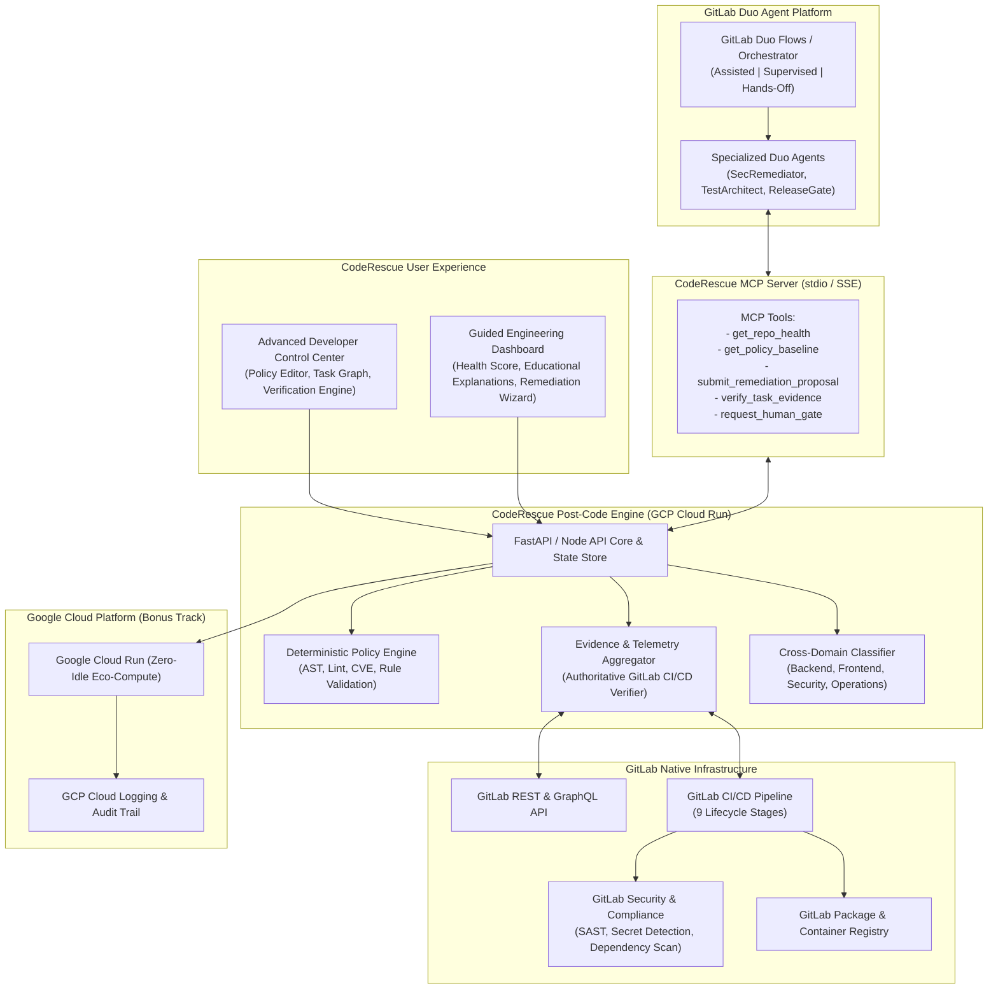

# System Architecture Document: CodeRescue
## Life After Code — GitLab Transcend Hackathon

**Document Version:** 1.0  
**Status:** Approved for Implementation  
**Target Release:** Hackathon MVP (Start Fresh Track)  
**Deployment Target:** Google Cloud Run (Serverless, Low Carbon Footprint)  

---

## 1. Executive Architecture Summary

**CodeRescue** is an evidence-based, policy-constrained post-code engineering platform built natively for the GitLab ecosystem. While traditional code generation stops when code is written, CodeRescue takes over the post-code DevSecOps lifecycle: verifying architectural health, remediating technical debt, enforcing security/privacy baselines, running multi-stage pipelines, and gating production release readiness.

CodeRescue uses the **GitLab Duo Agent Platform** as its exclusive AI reasoning and agentic orchestration engine, augmented by a custom **CodeRescue Model Context Protocol (MCP) Server** and an evidence-backed deterministic verification core.



---

## 2. Core Architecture Principles & Alignment

### 2.1 Alignment with Hackathon Requirements
1. **GitLab Duo Exclusivity**: All cognitive reasoning, root cause analysis, code fixes, and remediation proposals are delegated exclusively to GitLab Duo Agents via Duo Flows and MCP. CodeRescue does not embed secondary LLMs.
2. **Full DevSecOps Lifecycle (9 Stages)**: CodeRescue spans all 9 stages: `Plan`, `Create`, `Verify`, `Package`, `Secure`, `Release`, `Configure`, `Monitor`, and `Govern`.
3. **Three Levels of Autonomy**:
   - **Assisted**: User approves every single remediation action and CLI step.
   - **Supervised**: Duo executes multi-stage stabilization; user approves final outcome/merge.
   - **Hands-off**: Full closed-loop automation from issue creation to production deployment and monitoring.
4. **Google Cloud Native**: Containerized for Google Cloud Run with Workload Identity Federation, earning up to +0.2 bonus points.
5. **Environmentally Impactful (SCI Metric)**: Optimized caching, token-efficient MCP schemas, and zero-idle serverless execution minimizing energy consumption and carbon emissions.

---

## 3. Component Breakdown

### 3.1 CodeRescue Control Center (Frontend & API)
- **Frontend**: Clean, modern responsive interface built with glassmorphism, reactive task status, and real-time execution streaming.
- **Differentiated Modes**:
  - *Mode A (Advanced Developer)*: High-density post-code checklist, direct policy rule JSON/YAML editor, pipeline DAG inspector, instant release gate overrides.
  - *Mode B (Guided Engineering)*: Health gauges, beginner-friendly explanations ("Why this vulnerability matters"), visual stabilization roadmap.
- **Backend**: Python/Node lightweight API server managing:
  - Repository evidence cache (reducing API hits to GitLab).
  - Deterministic policy enforcement rules.
  - Audit log recorder.

### 3.2 CodeRescue MCP Server (`coderescue-mcp`)
The MCP Server provides standardized JSON-RPC 2.0 tools for GitLab Duo agents:

| Tool Name | Parameters | Purpose |
| :--- | :--- | :--- |
| `get_repository_evidence` | `repo_id`, `branch` | Fetches aggregated CI/CD, lint, SAST, and test evidence. |
| `query_policy_baseline` | `repo_id`, `category` | Returns active policy constraints (e.g. "Zero CRITICAL CVEs"). |
| `propose_remediation` | `task_id`, `diff`, `rationale` | Submits agent patch for deterministic validation. |
| `verify_pipeline_run` | `pipeline_id` | Authoritatively checks if a pipeline run verified the fix. |
| `request_approval_gate` | `action`, `risk_level` | Suspends execution and requests human sign-off in Assisted mode. |

### 3.3 GitLab Duo Flow Definitions
- Defined in `.gitlab/duo/flows/` within the repository.
- Orchestrates multi-step workflows:
  1. Trigger on push, issue creation, or manual dispatch.
  2. Query CodeRescue MCP for unresolved findings.
  3. Formulate branch and merge request with fix.
  4. Trigger CI/CD verification pipeline.
  5. Check verification evidence; notify or merge.

---

## 4. Cross-Domain Evidence & Classification

Findings are categorized into 4 core engineering domains with cross-cutting relationship tracking:

```
[Finding: Database Credentials Exposed in REST Endpoint]
  ├── Primary Domain: Security and Privacy (CWE-798 Hardcoded Secrets)
  ├── Secondary Domain: Backend Engineering (Unsafe configuration loading)
  ├── Cascading Risk: Operations & Delivery (Pipeline failure in Secret Detection stage)
  └── Root Cause: Missing `.env.vault` isolation in CI environment
```

---

## 5. Deployment Topology (Google Cloud Bonus Track)

- **Platform**: Google Cloud Run (Fully Managed Serverless Container).
- **Regions**: `us-central1` (low carbon grid index).
- **Security**: Secret Manager for GitLab Access Tokens, IAM Workload Identity for zero-token GitLab CI deployment.
- **Traffic**: HTTPS with automated TLS certificate management.

---

## 6. Verification and Evidence Integrity

To prevent AI hallucination:
- CodeRescue **never** marks an issue resolved simply because GitLab Duo claims it is fixed.
- Every remediation must be accompanied by an authoritative GitLab CI/CD Pipeline ID with status `SUCCESS` and verified test/security scanner artifacts.
